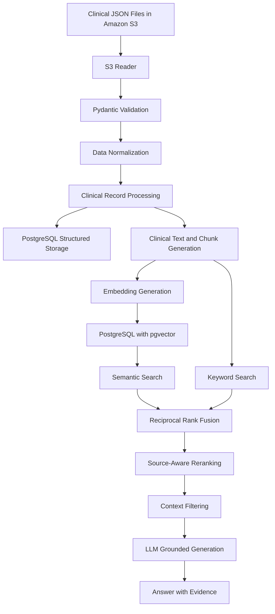

# Clinical AI Pipeline

**A modular, retrieval-augmented generation (RAG) pipeline for clinical data ingestion, retrieval, and evidence-grounded question answering.**

## Overview

Clinical information is often distributed across structured database records, consultation notes, medication records, diagnoses, investigations, and other clinical documents. Retrieving the right information from these sources requires more than a simple keyword search.

The Clinical AI Pipeline is a Python-based project designed to ingest clinical data, transform it into a consistent representation, store structured and searchable information, and retrieve relevant clinical evidence for grounded question answering.

The project combines traditional database operations, semantic search, keyword retrieval, hybrid ranking, and large language models (LLMs) to build a modular foundation for clinical information retrieval.

The primary objective is to develop a reliable, testable, and extensible RAG pipeline that can retrieve relevant evidence while making the limitations of the available information explicit.

> **Important:** This project is a software engineering and AI development project. It is not a medical device or a clinically validated decision-support system. Its outputs must not be used as a substitute for professional clinical judgment.

## Key Objectives

- Build a modular ingestion pipeline for clinical JSON records stored in Amazon S3.
- Validate incoming data and normalize inconsistent field naming.
- Store structured clinical records in PostgreSQL.
- Convert clinical information into searchable text chunks.
- Generate vector embeddings for semantic retrieval.
- Combine semantic and keyword retrieval using Reciprocal Rank Fusion (RRF).
- Improve candidate ordering using a lightweight, source-aware reranking strategy.
- Generate answers grounded in retrieved evidence.
- Develop automated tests, error handling, logging, and evaluation mechanisms.
- Establish a foundation for future API integration, workflow orchestration, and production deployment.

## Architecture

The pipeline is organized into modular stages.



*The diagram represents the intended end-to-end architecture. Components marked as planned or not yet integrated in the implementation status below should not be interpreted as completed workflow integrations.*

## Technology Stack

| Technology | Purpose |
|---|---|
| Python | Core application and pipeline logic |
| uv | Python dependency and project management |
| Pydantic | Data validation and request validation |
| Amazon S3 | Source storage for clinical JSON files |
| boto3 | AWS S3 integration |
| PostgreSQL | Structured clinical data and application storage |
| pgvector | Vector storage and similarity search |
| OpenAI Embeddings | Text embedding generation |
| OpenAI API | LLM-based grounded answer generation |
| LangChain | LLM integration and prompt management |
| pytest | Automated testing |
| Black | Python code formatting |
| Git and GitHub | Version control and project collaboration |

## Project Structure

The repository follows a modular Python package structure.

```text
clinical-ai-pipeline/
├── src/
│   └── clinical_ai_pipeline/
│       ├── config/
│       ├── ingestion/
│       ├── processing/
│       ├── storage/
│       ├── services/
│       ├── rag/
│       │   ├── models.py
│       │   ├── service.py
│       │   ├── hybrid_retrieval.py
│       │   └── reranker.py
│       ├── api/
│       └── utils/
├── scripts/
│   ├── check_hybrid_retrieval.py
│   └── ...
├── tests/
│   ├── test_rag_service.py
│   ├── test_hybrid_retrieval.py
│   └── test_reranker.py
├── data/
│   └── quarantine/
├── notebooks/
├── pyproject.toml
├── uv.lock
├── .python-version
├── .gitignore
└── README.md
```

*The tree is representative; additional modules and scripts may exist in the repository. The RAG package is being developed incrementally.*

## Data Ingestion and Processing

The ingestion pipeline is designed to process clinical JSON records from Amazon S3.

The main processing stages are:

1. **Read source data:** Retrieve JSON objects from S3.
2. **Validate records:** Use Pydantic models to validate the expected medication record structure.
3. **Normalize fields:** Convert field names into a consistent snake_case representation.
4. **Process records:** Coordinate validation, normalization, persistence, and clinical text preparation.
5. **Persist structured data:** Store the appropriate clinical entities in PostgreSQL.
6. **Prepare searchable content:** Create clinical text and chunks for retrieval.
7. **Generate embeddings:** Convert text chunks into vectors for semantic search.

The ingestion code also includes content hashing and a quarantine mechanism for records that cannot be processed successfully.

The initial validation run covered 1,475 JSON files, with all 1,475 passing the medication-record validation performed at that stage. This does not mean that the full end-to-end ingestion of every file has been completed.

## Retrieval-Augmented Generation (RAG)

The RAG component retrieves relevant clinical information and supplies it to an LLM to produce evidence-grounded answers.

### 1. Semantic retrieval

Semantic retrieval uses embeddings to identify text chunks that are conceptually related to a question, even when the wording differs.

The current embedding integration uses OpenAI's `text-embedding-3-small` model, with 1,536-dimensional vectors stored through pgvector.

### 2. Keyword retrieval

Keyword retrieval searches the text representation of clinical chunks using PostgreSQL full-text search.

This provides a complementary retrieval method for explicit terminology, medication names, and other textual matches.

### 3. Hybrid retrieval

The hybrid retrieval service combines semantic and keyword search results using **Reciprocal Rank Fusion (RRF)**.

RRF merges rankings from multiple retrieval methods without requiring their raw scores to be directly comparable. Candidate chunks are deduplicated and ranked using their positions in the individual result lists.

### 4. Source-aware reranking

A lightweight reranker reorders the fused candidates based on query-term overlap.

The current baseline also applies a small source relevance bonus when a query explicitly concerns medications and a candidate originates from the medication table.

This approach is deterministic and inexpensive, but it is a heuristic rather than a clinically validated relevance model. Its effectiveness needs to be evaluated against a representative set of clinical queries.

### 5. Grounded generation

The RAG service uses retrieved evidence to construct a prompt for the language model.

The prompt is designed to encourage the model to:

- Answer using the available evidence.
- Avoid inventing unsupported clinical facts.
- Acknowledge when the evidence is insufficient.
- Distinguish recorded information from conclusions.
- Treat retrieved content as untrusted data rather than instructions.

The service returns the answer together with evidence references and an insufficient-evidence indicator.

Retrieval scores should not be interpreted as calibrated probabilities of correctness.

## Current Implementation Status

The project is being built incrementally, with automated tests and manual checks at each stage.

| Component | Status |
|---|---|
| S3 JSON reading and record validation | Implemented and tested on an initial dataset |
| Field normalization | Implemented |
| Structured PostgreSQL persistence | Implemented |
| Clinical text and chunk preparation | Implemented |
| Embedding generation | Implemented and tested on samples |
| PostgreSQL vector similarity search | Implemented |
| PostgreSQL keyword search | Implemented |
| Hybrid retrieval with RRF | Implemented |
| Lexical, source-aware reranking | Implemented |
| Grounded RAG answer generation | Implemented and manually tested |
| Context filtering | Next development stage |
| Retrieval and answer-quality evaluation | Planned |
| Improved relevance scoring and reranker comparison | Planned |
| Expanded observability and resilience | Planned |
| API integration and deployment hardening | Planned |

The implementation status describes the current development state, not a claim of production readiness.

## Installation and Setup

### Prerequisites

- Python version compatible with the project configuration.
- [uv](https://docs.astral.sh/uv/)
- PostgreSQL with the pgvector extension.
- An AWS account and access to the configured S3 bucket.
- An OpenAI API key for embedding generation and LLM-based answer generation.

### 1. Clone the repository

```bash
git clone https://github.com/anukjose/clinical-ai-pipeline.git
cd clinical-ai-pipeline
```

### 2. Install dependencies

```bash
uv sync
```

If the development dependency group is defined separately in the project configuration, install it using the appropriate uv development dependency option.

### 3. Configure environment variables

Create a local `.env` file in the project root. Use the exact variable names expected by the project's settings module.

Example configuration template:

```dotenv
# AWS configuration
AWS_REGION=your-aws-region
AWS_ACCESS_KEY_ID=your-access-key
AWS_SECRET_ACCESS_KEY=your-secret-key
S3_BUCKET_NAME=your-bucket-name

# PostgreSQL configuration
DB_HOST=localhost
DB_PORT=5432
DB_NAME=your-database-name
DB_USER=your-database-user
DB_PASSWORD=your-database-password

# OpenAI configuration
OPENAI_API_KEY=your-openai-api-key
```

These names are illustrative. Confirm the actual environment variable names in the configuration module before using this template.

Never commit `.env`, API keys, AWS credentials, database passwords, or real patient data to GitHub. Prefer AWS IAM roles or another supported credential provider over long-lived access keys where possible.

### 4. Configure PostgreSQL

Create the database and enable pgvector using an account with the necessary permissions.

```sql
CREATE EXTENSION IF NOT EXISTS vector;
```

The remaining database setup—including schemas, tables, and indexes—must follow the SQL initialization or setup procedures included in the repository.

### 5. Run the automated tests

```bash
uv run pytest -q
```

To run the reranker tests separately:

```bash
uv run pytest tests/test_reranker.py -q
```

### 6. Run the manual hybrid retrieval check

After configuring PostgreSQL, loading test data, and setting up the required API credentials, run:

```bash
uv run python scripts/check_hybrid_retrieval.py
```

This script checks hybrid retrieval against the configured PostgreSQL database and prints ranked results, retrieval metadata, and text previews.

Use only authorized test data, and avoid printing identifiable patient information into terminal logs or shared outputs.

## Testing Strategy

Automated tests are used to verify component behavior before integration.

Current tests cover aspects of:

- RAG service behavior when evidence is unavailable.
- Reciprocal Rank Fusion and hybrid retrieval.
- Candidate ranking and tie handling.
- Result limits and input validation.
- Source-aware reranking.

Manual checks are also used to inspect real retrieval results and identify cases where irrelevant chunks appear above directly relevant evidence.

Passing unit tests demonstrates that the tested behavior works as expected. It does not establish clinical accuracy, retrieval completeness, or production readiness.

## Reliability, Security, and Clinical Safety

The project is being developed with the following principles:

- **Input validation:** Validate records and requests before processing.
- **Evidence grounding:** Avoid presenting unsupported facts as recorded clinical information.
- **Explicit uncertainty:** Return insufficient-evidence responses when appropriate.
- **Data minimization:** Retrieve and expose only information needed for a task.
- **Secret management:** Keep credentials outside version control.
- **Error handling:** Distinguish invalid records, processing failures, and retrieval failures.
- **Observability:** Record useful operational metadata without unnecessarily logging sensitive clinical content.
- **Testing:** Validate behavior using automated tests and representative examples.
- **Human oversight:** Do not use the system as an autonomous substitute for qualified clinical decision-making.

Before any real-world clinical deployment, the pipeline would require appropriate privacy and security reviews, access controls, auditability, clinical evaluation, operational monitoring, and assessment against applicable legal and regulatory requirements.

## Development Roadmap

The planned development sequence is:

1. Complete context filtering.
2. Improve evidence selection and grounded generation.
3. Build a retrieval evaluation dataset and measure retrieval quality.
4. Compare reranking approaches using representative queries.
5. Strengthen observability, error handling, and resilience.
6. Add or improve API integration.
7. Evaluate workflow orchestration with LangGraph and tool integration where appropriate.
8. Assess deployment requirements, security controls, and operational readiness.
9. Run an end-to-end ingestion and retrieval evaluation on the full authorized dataset.

Each stage should be independently testable before it is integrated into the complete pipeline.

## Future Extensions

Potential extensions include:

- More advanced reranking models.
- Query transformation and query expansion.
- Metadata-aware retrieval and filtering.
- Retrieval evaluation metrics such as Recall@K, Precision@K, and Mean Reciprocal Rank.
- Answer-grounding and citation-quality evaluation.
- LangGraph-based orchestration for more complex workflows.
- MCP-based tool integration where it adds value.
- FastAPI endpoints for controlled access to retrieval and question-answering services.
- Improved tracing, monitoring, and production deployment automation.

These are development opportunities, not claims that the corresponding functionality is already complete.

## Contributing

The project is developed incrementally. Changes should preserve modularity, include appropriate automated tests, and avoid exposing sensitive clinical information.

Suggested workflow:

1. Create a focused change.
2. Add or update tests.
3. Run the relevant tests and the full test suite.
4. Review the changes for secrets and sensitive data.
5. Commit the change with a descriptive message.
6. Update the documentation when implementation status changes.

## License

No open-source license has been specified yet. Until a license is added to the repository, reuse and redistribution permissions should not be assumed.

## Acknowledgments

Built as a practical exploration of Python, clinical data engineering, PostgreSQL, vector search, hybrid retrieval, and evidence-grounded LLM applications.
